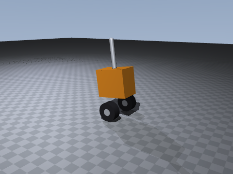
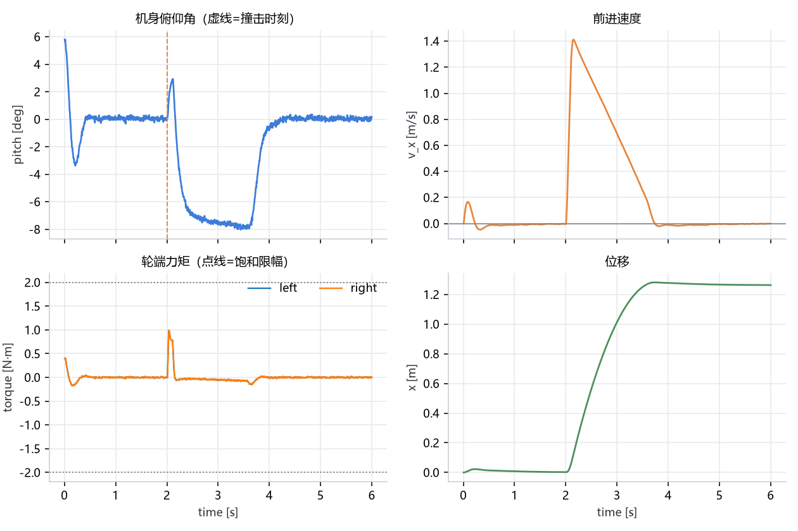
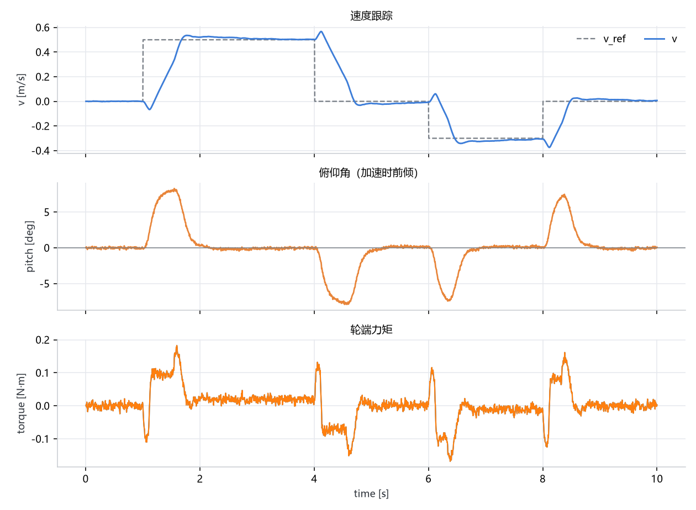
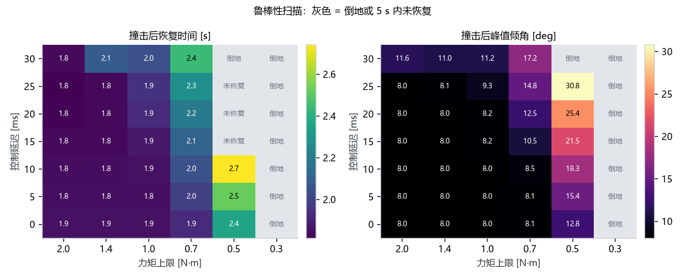
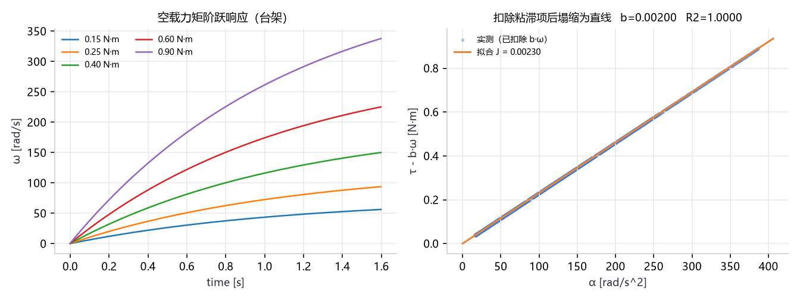
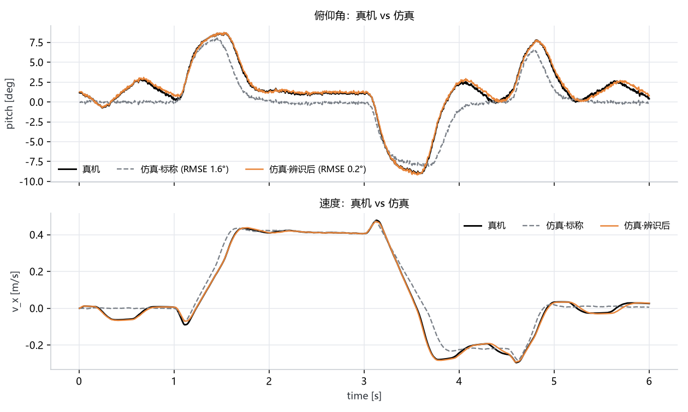

# balance-sim2real

双轮平衡车的 MuJoCo 建模 / 串级控制 / 参数辨识 / 真机数据对齐。

[](https://github.com/wentx333/balance-sim2real/actions/workflows/ci.yml)
[](https://www.python.org/)
[](https://mujoco.org/)

[English](README.en.md) · [30 秒演示解说词](DEMO_SCRIPT.md)

这是我在做 STM32 平衡车时缺的那一半：**在写进单片机之前，先在仿真里把控制律、
执行器非理想项和 sim2real 误差搞清楚**。所以这个仓库不是"跑个 demo 截图"，而是
一套可以复现的实验流程 —— 每个实验都有明确的输入、指标和结论。



---

## 它解决什么问题

平衡车看着简单，实车上踩的坑却很固定：

| 现象 | 根因 | 本仓库里对应的实验 |
| --- | --- | --- |
| 被推一把之后车反向冲出去 | 外环积分饱和，没有抗饱和 | 01（条件积分） |
| 轮子嗡嗡响、电机发烫 | 陀螺噪声被 D 项放大 | 02（D 项低通） |
| 换一台电机就要重调一遍 | 没有做参数辨识 | 04（台架辨识 J/b） |
| 仿真调好、上机就抖 | 延迟/零偏/死区没建模 | 03、05 |

---

## 快速开始

```bash
pip install -r requirements.txt

python experiments/01_balance.py      # 抗扰恢复
python experiments/02_track.py        # 速度跟踪
python experiments/03_sweep.py        # 延迟 x 力矩上限 鲁棒性扫描
python experiments/04_sysid_motor.py  # 台架参数辨识
python experiments/05_sim2real.py --selftest   # 真机数据回放 + 反推参数
python experiments/06_render.py       # 渲染 GIF（需要 OpenGL）
```

一键全跑：`python run_all.py`。所有图和数据落在 `results/`，CSV 可以直接拿去和
真机日志对齐。

> Windows 控制台默认 GBK，图里的中文没问题；如果终端里中文显示成乱码，
> 先 `chcp 65001`。

---

## 目录

```
model/balance_car.xml    MJCF：轮子/车身/桅杆，摩擦、armature、阻尼都在这里
src/env.py               环境封装：延迟、IMU 噪声与零偏、编码器量化、电机死区
src/controller.py        串级 PID：速度外环 -> 俯仰目标 -> 力矩内环，+ 转向环
src/metrics.py           阶跃指标（超调/上升/调节/稳态误差）与跟踪指标
src/plot.py              统一出图风格（中文字体、配色）
experiments/01..06       六个实验，各自独立可跑
data/real_log.csv        真机日志模板（--selftest 会用仿真数据填充）
results/                 图 + CSV
```

---

## 模型

- 轮半径 R = 50 mm，轮距 170 mm，整备质量 ≈ 1.95 kg
- 轮胎 `condim=4`（滚动 + 侧向摩擦模型完整），`cone=elliptic`
- 轮子带 `armature=0.002`（转子惯量折算）和 `damping=0.002`
- 物理步长 1 ms，控制周期 5 ms（200 Hz，和 STM32 固件一致）

**为什么物理步长比控制周期小 5 倍**：接触求解需要更细的步长才稳定；控制周期则是
真机上的实际采样率，两者不能混为一谈。`env.apply()` 内部自动跑 5 个子步。

---

## 控制器

```
速度误差 --(PI, 抗饱和)--> 俯仰目标 theta_ref --(PD)--> 轮端力矩
                                 ^                        |
                                 |                        v
                          俯仰角/角速度            饱和 + 斜率限幅
```

四个"真机上必须有、仿真里容易忘"的细节，都在 `controller.py` 里显式实现：

1. **条件积分抗饱和**：外环已经顶到 `theta_max` 且误差方向一致时停止积分。
   没有这一条，被撞后 `theta_ref` 会在限幅上顶 2 秒，积分打满，车随后反向冲出去。
2. **D 项一阶低通**（60 Hz）：陀螺噪声被 `kd` 直接放大成力矩抖动。
3. **速度指令斜坡**（1.2 m/s²）：阶跃指令会让车"耸一下"，前 0.1 s 车轮先倒退再前冲。
4. **力矩斜率限幅**（120 N·m/s）：模拟驱动器电流环的上升率。

---

## 实验结果

### 01 抗扰恢复
初始前倾 5.7°，第 2.0 s 施加 18 N × 0.1 s 的水平推力（≈1.0 m/s 的撞击）。

| 指标 | 数值 |
| --- | --- |
| 撞击后峰值速度 | 1.41 m/s |
| 撞击后峰值倾角 | 8.0° |
| 恢复到 ±2° 用时 | 1.85 s |
| 峰值力矩 | 0.99 N·m（上限 2.0，未饱和） |
| 最大位移 | 1.28 m |
| 末速度 | -0.001 m/s |



### 02 速度跟踪
方波指令 0 → 0.5 → 0 → -0.3 → 0 m/s。

| 段 | 目标 | 上升 | 超调 | 调节(±2%) | 稳态误差 |
| --- | --- | --- | --- | --- | --- |
| 1 | 0.50 | 380 ms | 7.1% | 1.85 s | 0.61% |
| 2 | 0.00 | 405 ms | 6.3% | 1.89 s | 2.38% |
| 3 | -0.30 | 200 ms | 14.4% | 1.86 s | 3.48% |
| 4 | 0.00 | 220 ms | 8.9% | 1.78 s | 1.84% |



### 03 鲁棒性扫描
延迟 0–30 ms × 力矩上限 0.35–2.0 N·m，共 42 种组合，看性能在哪崩。

结论很清楚：**力矩上限是硬约束**。上限 0.35 N·m 时 7 档延迟全部倒地；0.5 N·m 时
延迟 ≥10 ms 就开始倒。延迟本身（0–15 ms）对恢复时间影响不到 0.3 s —— 也就是说，
先解决扭矩裕度，再谈控制延迟。



### 04 台架参数辨识
把车架空（关重力、断地面接触），给定力矩阶跃，测转速上升曲线，对
`tau = J·dω/dt + b·ω` 做最小二乘。

| 参数 | 辨识值 | 模型真值 | 误差 |
| --- | --- | --- | --- |
| J | 0.002302 kg·m² | 0.002197 | +4.8% |
| b | 0.002000 N·m·s/rad | 0.002000 | 0% |

误差主要来自用差分求角加速度。真机上做同样的步骤，就能标出"换了一台电机该改哪个参数"。



### 05 真机数据回放与参数反推
读入 200 Hz 的真机日志（`t, v_ref, vx, pitch`），用同样的 `v_ref` 序列在仿真里重放，
比较俯仰角。然后分两步反推参数：先标 IMU 零偏（一阶主导误差），再标质量。

在 `--selftest` 模式下，用一份"被改坏的假真机"（IMU 装歪 1.2°、质量 1.25 倍、
摩擦 0.7 倍、延迟 10 ms、死区 0.04 N·m）验证整条流程：

- 标称仿真：俯仰角 RMSE **1.64°**
- 反推出零偏 **+1.3°**（真值 1.2°）
- 再反推质量 **1.35×**（真值 1.25×）
- 最终 RMSE **0.22°**，失配降低 **87%**

一个诚实的负面结论：**摩擦系数在这条轨迹上不可辨识** —— 把 μ 从 0.5 倍扫到 1.4 倍，
RMSE 一直是 0.22°，因为轮子全程没打滑。要标摩擦得专门做急加速/急刹的激励。



---

## 已知限制

- 模型是平面直线运动，转向只做了偏航力矩环，没有做完整的三维转弯（差速 + 侧倾）。
- 没有建模电机齿槽转矩、磁滞和温漂。
- 05 的参数搜索是粗网格，够用但不收敛到最优；换成 scipy 的 `minimize` 会更快。

## 下一步

- [ ] 把控制器用 C 重写一版，和 Python 版本逐点对比（保证移植不走样）
- [ ] 加 `--from-real` 模式，直接吃实车 CAN 日志
- [ ] 在 Isaac Lab 里搭同一个模型，比较两个引擎的接触求解差异
